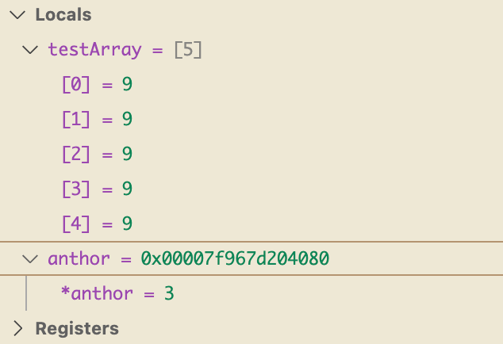

### 原生数组
数组本质上就是一组元素的集合
```cpp
#include <iostream>

class Entity{
public:

};
int main()
{   
    int testArray[5];
    int* ptr = testArray;
    for (int i = 0; i < 5; i++)
    {
        /* code */
        testArray[i] = 2;
    }    
    testArray[2] = 5;
    *(ptr+2)  = 2;
    std::cin.get();
}
```

testArray[2] = 5 执行之前

testArray[2] = 5 执行后

*(ptr+2)  = 2 执行后


- 栈分配
直接通过字面量赋值的
```cpp
int main()
{   
    int testArray[5];
    std::cin.get();
}
```
在函数作用域结束之后就会被销毁了
- 堆分配
```cpp
#include <iostream>

class Entity{
public:

};
int main()
{   
    int testArray[5];
    int* anthor = new int[5];
    for (int i = 0; i < 5; i++)
    {
        /* code */
        testArray[i] = 9;
        anthor[i] = 3;
    }    
    
    std::cin.get();
}
```

通过new关键字新建数组
执行完成不会自动被销毁，得手动删除执行delete[]

同时使用new关键字变量是一个指针存储的是一个地址，这个地址会间接执行实际的数据
这就是所谓的间接寻址
### std::array
```cpp
#include <iostream>
#include <array>
class Entity{
public:

};
int main()
{   
    int testArray[5];
    std::array<int, 5> another;
    for (int i = 0; i < another.size(); i++)
    {
        /* code */
        testArray[i] = 9;
        another[i] = 3;
    }    
    
    std::cin.get();
}
```
这个是C++ 11 官方内置的数组