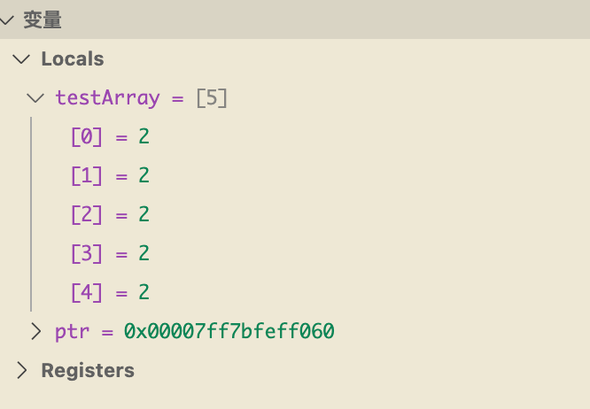
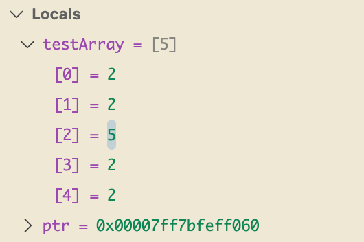
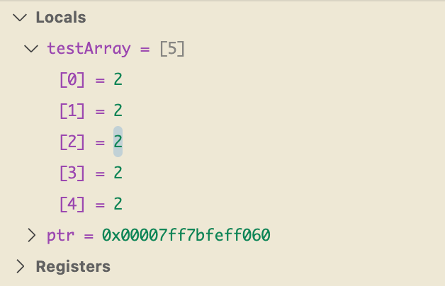

### 原生数组
数组本质上就是一组元素的集合
```cpp
#include <iostream>

class Entity{
public:

};
int main()
{   
    int testArray[5];
    int* ptr = testArray;
    for (int i = 0; i < 5; i++)
    {
        /* code */
        testArray[i] = 2;
    }    
    testArray[2] = 5;
    *(ptr+2)  = 2;
    std::cin.get();
}
```

testArray[2] = 5 执行之前

testArray[2] = 5 执行后

*(ptr+2)  = 2 执行后

- 堆分配
  

- 栈分配

### std::array
这个是C++ 11 官方内置的数组