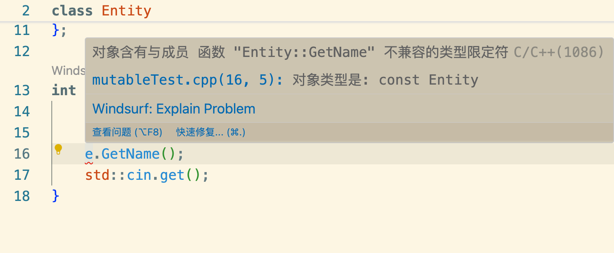
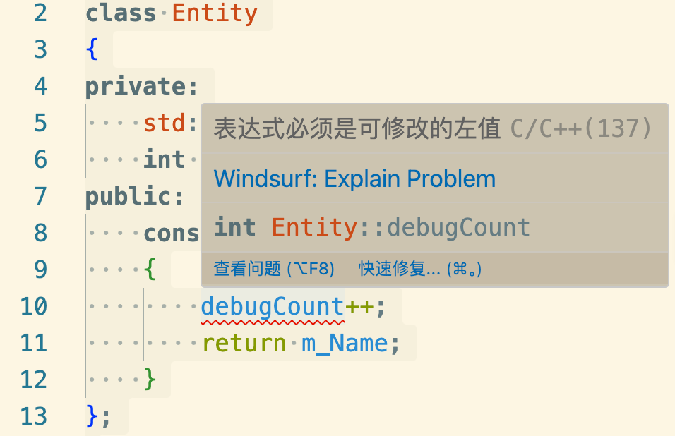
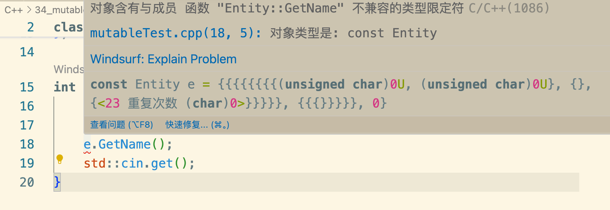

```cpp
#include<iostream>
class Entity
{
private:
    std::string m_Name;
public:
    const std::string& GetName() const
    {
        return m_Name;
    }
};

int mian(){

    const Entity e;
    e.GetName();
    std::cin.get();
}
```
此时调用e.GetName();不会报错
当剔除GetName的const关键词修饰符
```cpp
#include<iostream>
class Entity
{
private:
    std::string m_Name;
public:
    const std::string& GetName()
    {
        return m_Name;
    }
};

int mian(){

    const Entity e;
    e.GetName();
    std::cin.get();
}
```
会发现报错了

这里是因为限制了const类对象与const函数的调用关系，指的是常量函数和类 不可变 const类不可调用非const函数

### mutable
```cpp
#include<iostream>
class Entity
{
private:
    std::string m_Name;
    int debugCount = 0;
public:
    const std::string& GetName() const
    {
        debugCount++;
        return m_Name;
    }
};

int mian(){

    const Entity e;
    e.GetName();
    std::cin.get();
}
```
const函数指的是常量函数，但有的时候会出于调试目的想看某个const常量函数调用的次数，因此会在函数中定义类似于debugCount进行计数操作
但会看到编译器报错了

```cpp
#include<iostream>
class Entity
{
private:
    std::string m_Name;
    int debugCount = 0;
public:
    const std::string& GetName()
    {
        debugCount++;
        return m_Name;
    }
};

int mian(){

    const Entity e;
    e.GetName();
    std::cin.get();
}
```

将const从函数中移除又可以看到编译器不报错了，但是类对象调用又报错了

很矛盾，这时候mutable关键字可以解决这个问题
```cpp
#include<iostream>
class Entity
{
private:
    std::string m_Name;
    mutable int debugCount = 0;
public:
    const std::string& GetName() const
    {
        debugCount++;
        return m_Name;
    }
};

int mian(){

    const Entity e;
    e.GetName();
    std::cin.get();
}
```
可以看到编译器完全不报错了

mutable关键字修饰符相当于类内部的 const 方法实际上能够修改这个成员

### 配合lambda表达式
```cpp
#include<iostream>
class Entity
{
private:
    std::string m_Name;
    mutable int debugCount = 0;
public:
    const std::string& GetName() const
    {
        debugCount++;
        return m_Name;
    }
};

int mian(){

    const Entity e;
    e.GetName();
    int x = 8;
    auto f = [=]() mutable//按值传递的
    {
        x++;
        std::cout << x<< std::endl;
    }
    
    std::cin.get();
}
```
int x = 8;
auto f = [=]() {
x++; // 编译报错
};
原因是C++ 编译器会在底层为你生成一个匿名的类（闭包类），大致等价于：
```cpp
class __Lambda_1 {
private:
    int x; // 按值捕获，x 变成了闭包类的成员变量

public:
    __Lambda_1(int val) : x(val) {}

    // 关键点：默认情况下，operator() 带有 const 修饰！
    void operator()() const {
        x++; // 报错！在 const 成员函数内部，不能修改成员变量
    }
};
```

加了mutable
```cpp
class __Lambda_1 {
private:
    int x;

public:
    __Lambda_1(int val) : x(val) {}

    // 加了 mutable 后，operator() 变成了普通的非 const 成员函数
    void operator()() {
        x++; // 合法，可以修改内部成员变量 x
    }
};
```
- 注意事项
```cpp
int x = 8;
auto f = [=]() mutable {
    x++;
    std::cout << "Inside: " << x << std::endl; // 输出 9
};
f();
std::cout << "Outside: " << x << std::endl;     // 输出仍为 8
```
mutable 允许修改的仅仅是 Lambda 内部保存的那份副本，外部原本的 int x 不会受到任何影响：