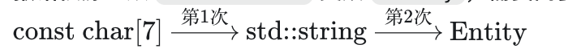

何为"隐式（Implicit）"
- 概念导入：“隐式（Implicit）”意味着开发者不需要在代码中写下显式的转换指令，编译器在后台自动、静默地替你完成类型转换。
- 核心语法规则：在 C++ 中，如果一种数据类型在上下文中被当成了另一种类型使用，且两者之间存在一条合法的转换途径，编译器就会尝试执行隐式转换。

```cpp
class Entity {
private:
    std::string m_Name;
    int m_Age;
public:
    Entity(const std::string& name)
        : m_Name(name), m_Age(-1) {}

    Entity(int age)
        : m_Name("Unknown"), m_Age(age) {}
};
```
- 常规用法：开发者通常会写 Entity a("Cherno"); 或 Entity b(22)
- 反常规用法
```cpp
Entity b = 22; // 赋值一个整型给 Entity 对象，完全合法编译！
```
其实是隐式构造：- Entity 并不是整数，但因为 Entity 拥有一个接受单一整型参数的构造函数（Converting Constructor / 转换构造函数），编译器把整型 22 自动当成该构造函数的参数，并在后台隐式构造了一个 Entity 对象

### 传递int和字符串
```cpp
void PrintEntity(const Entity& entity) {
    // 打印逻辑...
}
```
PrintEntity(22)：可以编译通过，因为编译器将22隐式构造为临时 Entity 对象传进去

PrintEntity("Cherno")：编译报错，不是 std::string，而是 const char[7]（以 \0 结尾的字符数组）

编译器在一次隐式转换链路中，只允许执行【一次】用户自定义的隐式类型转换（Only one user-defined conversion is allowed）。

报错根源：从 const char* 变成 Entity，需要两步自定义转换:

因为需要连续两次转换，直接超出了编译器允许的上限，因此编译器拒绝编译

修复方案：
- 1. 显式构造一层 std::string：PrintEntity(std::string("Cherno"));（此时只需 string $\to$ Entity 一次隐式转换）
- 2. 显式构造 Entity：PrintEntity(Entity("Cherno"))
    
### explicit关键字
explicit 是修饰构造函数声明的关键字，用于强制禁用该构造函数的隐式转换行为。
```cpp
class Entity {
public:
    explicit Entity(int age) : m_Name("Unknown"), m_Age(age) {}
};
```
加上explicit关键字 之前的隐式构造全部都会编译报错

```cpp
Entity b(22);               // 合法（直接初始化）
PrintEntity(Entity(22));     // 合法（显式构造）
PrintEntity((Entity)22);     // 合法（显式类型转换）
```
加上explicit关键字只能够直接初始化和显示构造