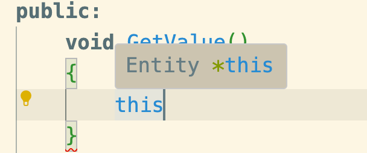

- 定义：this 是 C++ 中的一个核心关键字，它只能在类的非静态成员函数（Member Functions）内部访问。
- 本质：它是一个指针，指向当前调用该方法的对象实例（Current Object Instance）。
- 为什么需要它？ 非静态方法必须由一个具体的有效对象来触发调用，而成员函数在执行时，就是通过 this 指针来确认自己到底在操作哪一块内存中的数据


编译器在编译时，会默默地把 this 指针作为函数的第一个隐藏形参塞进去。

自己写的函数
```cpp
void Entity::Print();
e.Print();
```
实际

```cpp
void Entity_Print(Entity* const this); // 隐藏的第一个参数
Entity_Print(&e);                       // 将当前对象地址传给 this（通常放在 ECX 寄存器或 RDI 寄存器中）
```

### 变量重名消歧义
```cpp
class Entity {
public:
    int x, y;

    Entity(int x, int y) {
        // 如果想在构造函数体内赋值：
        x = x; // ❌ 编译可以通过，但毫无意义！只是局部形参 x 给自己赋值
    }
};
```
借助this
this 是指向当前实例的指针，所以可以通过指针访问成员：
```cpp
this->x = x;
this->y = y;
```
解引用用法
```cpp
(*this).x = x;
```


在非 const 成员函数中，如果你把鼠标悬停在 this 上，它的完整类型其实是：
```cpp
Entity* const this; // 顶层 const（Top-level const）
```

```cpp
- this = nullptr; // ❌ 编译直接报错！不能给 this 赋新地址
```
