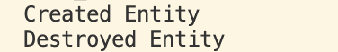

栈（Stack）本质上是一个（**后进先出LIFO - Last In First Out**）的数据结构。

每当我们进入一个新的作用域（Scope），就相当于向书堆顶端新放了一本书；在该作用域内声明的所有局部变量，就像是在这本书上写字。
一旦作用域结束，这本书被移走（弹出退栈），上面记录的所有局部变量和对象将当场被全数销毁，占用的内存立刻释放。

### 构造函数创建析构函数销毁
```cpp
#include <iostream>

class Entity {
public:
    Entity() {
        std::cout << "Created Entity" << std::endl;
    }
    ~Entity() {
        std::cout << "Destroyed Entity" << std::endl;
    }
};
```

### 栈分配
```cpp
int main() {
    {
        Entity e; // 栈上分配
    } // 离开花括号，离开作用域
    std::cin.get();
}
```

### 堆分配
```cpp
int main() {
    {
        Entity* e = new Entity(); // 堆上分配
    } // 离开作用域，仅指针变量 e 本身销毁，所指堆内存未释放！
    std::cin.get();
}
```

### 错误用法

```cpp
// 危险错误示范：
int* CreateArray() {
    int array[50]; // 分配在当前函数的栈帧上
    // ... 对 array 进行填充 ...
    return array;  // ❌ 致命错误！返回局部栈数组的首地址
}

int main() {
    int* a = CreateArray();
    // 此时 a 已经是指向死尸内存的悬挂指针（Dangling Pointer）！
}
```
一旦 CreateArray() 函数执行完毕返回，该函数对应的整个栈帧（那本书）被彻底弹出、作废。返回的指针所指向的内存随时会被后续其他函数调用或系统操作无情覆盖

若想在函数外继续使用这块内存，必须使用堆分配：int* array = new int[50];，或者通过传出参数从外界传入已分配的栈引用

# 利用栈变量析构函数帮助释放堆内存
```cpp
#include <iostream>

class Entity1 {
public:
    Entity1() {
        std::cout << "Created Entity" << std::endl;
    }
    ~Entity1() {
        std::cout << "Destroyed Entity" << std::endl;
    }
};

class ScopedPtr {
private:
    Entity1* m_Ptr;
public:
    ScopedPtr(Entity1* ptr) : m_Ptr(ptr) {}
    ~ScopedPtr() {
        delete m_Ptr;
    }
};

int main() {
    {
        ScopedPtr e = new Entity1();
    }
    return 0;
}
```
