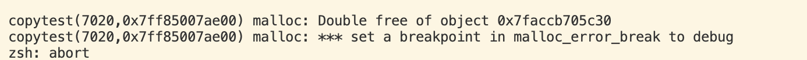

拷贝的本质：拷贝（Copying）指的就是复制数据、复制内存。它在内存的另一块地方划出同样大小的空间，把数据逐比特写入，使得程序拥有两份各自独立的副本

双刃剑效应：
- 正面：我们需要两份数据独立修改、互不干扰；
- 负面：内存拷贝是有 CPU 与堆内存开销的！如果你仅仅是想读取数据，或者原地修改已有数据，不必要的拷贝会白白榨干程序的运行性能

### 原生类型、结构体与指针的本质区别
- 基本原生类型
```cpp
int a = 2;
int b = a; // 内存复制
b = 3;     // 修改 b，a 仍然是 2
```

本质：a 和 b 占据两个不同的栈内存地址，互不影响
- 自定义结构体
```cpp
struct Vector2 { float x, y; };
Vector2 a = { 2.0f, 3.0f };
Vector2 b = a; // 逐成员按值拷贝
b.x = 5.0f;    // 修改 b.x，a.x 依然是 2.0f
```
本质：C++ 默认会把 a 所在的内存块（8 个字节）逐字节复制到 b 的内存块中，属于两份独立对象

- 指针类型
```cpp
Vector2* a = new Vector2();
Vector2* b = a; // 拷贝指针！
b->x = 5.0f;    // 致命点：a->x 也随之变成了 5.0f！
```
写下 b = a 时，你依然在进行拷贝，但你拷贝的仅仅是指针本身（那个 8 字节的内存地址值），而不是指针所指向的堆内存对象！因此 a 和 b 指向了同一块内存，修改其中一个，另一个也感知改变
引用（Reference）不能被重新绑定，把一个引用赋值给另一个，改的是底层的对象。除引用之外，C++ 中的赋值全都是在拷贝数值
### 手写string
```cpp
#include <iostream>
#include <cstring>

class String {
private:
    char* m_Buffer;
    unsigned int m_Size;
public:
    String(const char* string) {
        m_Size = strlen(string);
        m_Buffer = new char[m_Size + 1]; // +1 预留给空终止符 '\0'
        memcpy(m_Buffer, string, m_Size);
        m_Buffer[m_Size] = 0;            // 手动追加末尾 '\0'
    }

    ~String() {
        delete[] m_Buffer; // 释放堆上字符数组
    }

    // 重载下标运算符方便按索引修改
    char& operator[](unsigned int index) {
        return m_Buffer[index];
    }

    // 声明为友元函数，以便外部流运算符直接读取 private 的 m_Buffer
    friend std::ostream& operator<<(std::ostream& stream, const String& string);
};

std::ostream& operator<<(std::ostream& stream, const String& string) {
    stream << string.m_Buffer;
    return stream;
}
```
- 字符串拷贝
```cpp
int main() {
    String string = "Cherno";
    String second = string; // 发生拷贝！

    second[2] = 'a'; // 试图将第二个字符串改为 "Charno"

    std::cout << string << std::endl;
    std::cout << second << std::endl;

    std::cin.get();
}
```

两个 "Charno"！修改 second，竟然把原本的 string 也给改了
同时退出程序报错了

程序重复释放内存报错
浅拷贝（Shallow Copy）与双重释放（Double Free）
- 默认情况下，C++ 编译器隐式生成的拷贝操作是浅拷贝，仅仅执行类似 memcpy 的动作
```cpp
second.m_Buffer = string.m_Buffer; // 两个指针存的地址完全一样（例如都是 0xAE0440）
second.m_Size = string.m_Size;
```
- 影响A（共用内存）：两个对象共享同一份字符堆内存，因此修改一个，另一个必然跟着改变。
- 影响B（双重释放导致崩溃）：
  - 1，当离开 main 函数的作用域时，栈对象逆序析构：1. second 析构，执行 delete[] second.m_Buffer，该堆内存被操作系统回收；
  - 2，string 接着析构，再次执行 delete[] string.m_Buffer！
  - 3，操作系统内存管理器发现同一个堆地址被连续释放了两次，判定为严重堆破坏（Heap Corruption），直接把程序进程强制Crash
  
- 手写拷贝构造函数执行“深拷贝”
  完全不希望被拷贝（例如 std::unique_ptr），标准做法是在类内部直接弃置拷贝构造：
```cpp
String(const String& other) = delete;
```  
一旦有拷贝代码，编译阶段直接报错

深拷贝（Deep Copy）构造函数
```cpp
class String {
    // ...
public:
    // 拷贝构造函数签名：接收同类型对象的常量引用
    String(const String& other)
        : m_Size(other.m_Size) // 基础类型直接拷数值
    {
        // 关键：在堆上独立开辟一块属于自己的全新内存！
        m_Buffer = new char[m_Size + 1];
        // 将原对象内存中的真实数据内容完整复制过来
        memcpy(m_Buffer, other.m_Buffer, m_Size + 1);
    }
};
```
完整测试
```cpp
#include <iostream>
#include <cstring>

class String {
private:
    char* m_Buffer
    ;
    unsigned int m_Size;
public:
    String(const char* string) {
        m_Size = strlen(string);
        m_Buffer = new char[m_Size + 1]; // +1 预留给空终止符 '\0'
        memcpy(m_Buffer, string, m_Size);
        m_Buffer[m_Size] = 0;            // 手动追加末尾 '\0'
    }
    // 拷贝构造函数签名：接收同类型对象的常量引用
    String(const String& other)
        : m_Size(other.m_Size) // 基础类型直接拷数值
    {
        // 关键：在堆上独立开辟一块属于自己的全新内存！
        m_Buffer = new char[m_Size + 1];
        // 将原对象内存中的真实数据内容完整复制过来
        memcpy(m_Buffer, other.m_Buffer, m_Size + 1);
    }
    ~String() {
        delete[] m_Buffer; // 释放堆上字符数组
    }

    // 重载下标运算符方便按索引修改
    char& operator[](unsigned int index) {
        return m_Buffer[index];
    }

    // 声明为友元函数，以便外部流运算符直接读取 private 的 m_Buffer
    friend std::ostream& operator<<(std::ostream& stream, const String& string);
};

std::ostream& operator<<(std::ostream& stream, const String& string) {
    stream << string.m_Buffer;
    return stream;
}
int main() {
    String string = "Cherno";
    String second = string; // 发生拷贝！

    second[2] = 'a'; 

    std::cout << string << std::endl;
    std::cout << second << std::endl;

    std::cin.get();
}
```

