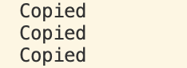

当 std::vector 的容量不足时，会发生重新分配（Reallocation）：
1. 申请更大堆内存；
2. 将老数据逐个拷贝过去；
3. 释放旧内存。
   这个过程不仅伴随着昂贵的堆内存申请/释放，更伴随着大量已有对象的深拷贝

因此需考虑vector优化   
```cpp
#include <iostream>
#include <vector>

struct Vertex {
    float x, y, z;

    // 带参构造函数
    Vertex(float x, float y, float z)
        : x(x), y(y), z(z) {}

    // 拷贝构造函数（作为探针）
    Vertex(const Vertex& other)
        : x(other.x), y(other.y), z(other.z) {
        std::cout << "Copied" << std::endl;
    }
};
```

在 main 函数中连续 push_back 三个顶点：
```cpp
int main() {
    std::vector<Vertex> vertices;
    vertices.push_back(Vertex(1, 2, 3));
    vertices.push_back(Vertex(4, 5, 6));
    vertices.push_back(Vertex(7, 8, 9));

    std::cin.get();
}
```

输出了6次 不符合预期

### 多次输出拷贝的原因
  执行第 1 行：vertices.push_back(Vertex(1, 2, 3));
- 现象：输出 1 次 Copied。
- 原因（原因 A：传参拷贝）：Vertex(1, 2, 3) 首先在 main 函数当前的栈帧中被临时构造出来；为了存进 vector，必须把它从当前栈内存拷贝一份放到 vector 内部的堆内存中。
- 此时 size = 1, capacity = 1。

执行第 2 行：vertices.push_back(Vertex(4, 5, 6));
- 现象：输出了 2 次 Copied（累计 3 次）。
- 原因：
   1. 传参拷贝：新元素 (4, 5, 6) 从栈拷贝进 vector（第 1 次）；
   2. 扩容迁移（原因 B）：此时原有容量为 1 已满，vector 扩容到容量 2，不得不把老元素 (1, 2, 3) 从旧内存深拷贝到新内存（第 2 次）！
- 此时 size = 2, capacity = 2。

执行第 3 行：vertices.push_back(Vertex(7, 8, 9));
- 现象：输出了 3 次 Copied（累计 6 次）！
- 原因：
   1. 传参拷贝：新元素 (7, 8, 9) 从栈拷贝进 vector（第 1 次）；
   2. 再次扩容迁移（原因 B）：容量 2 再次耗尽，vector 扩容到 3（或更高），把之前的两个老元素 (1, 2, 3) 和 (4, 5, 6) 重新全部深拷贝一次到新内存（第 2 次和第 3 次）

### 利用 reserve() 消灭扩容拷贝
明确知道这个阶段需要压入 3 个元素，为什么要任由 vector 像无头苍蝇一样扩容两次？直接告诉它：“把容量预留到 3！”

```cpp
int main() {
    std::vector<Vertex> vertices;
    vertices.reserve(3); // 预先分配足以容纳 3 个元素的堆内存！

    vertices.push_back(Vertex(1, 2, 3));
    vertices.push_back(Vertex(4, 5, 6));
    vertices.push_back(Vertex(7, 8, 9));
}

```

可以看到只输出3次
将reserve修改成resize

报错了无法通过编译
- reserve(n)：仅分配内存，不构造对象。它只改变 capacity（预留空间），size 依然是 0，容器内还是空的，绝不会调用对象的构造函数！
- resize(n)：不仅分配内存，而且立即原地调用默认构造函数创建出 $n$ 个对象！改变 size 也改变 capacity。如果不希望提前生成一堆无意义的默认假对象，严禁乱用 resize

### 利用 emplace_back() 消灭栈传参拷贝
3 次拷贝从何而来？
是因为我们写了 Vertex(1, 2, 3)。这行代码是在当前 main 函数的作用域栈帧里构造的临时对象，再通过 push_back 按值（或通过拷贝）传给 vector 内部

既然 vector 已经通过 reserve(3) 准备好了未初始化的堆内存，为什么我们不能跳过栈帧，直接在 vector 的堆内存上“就地（In-place）”构造这个对象呢

将所有的 push_back 改写为 emplace_back，并且不再传入 Vertex(...) 对象，而是直接传入构造函数所需的实参列表：
```cpp
int main() {
    std::vector<Vertex> vertices;
    vertices.reserve(3); // 1. 预留空间

    // 2. 就地构造：直接传入 3 个 float 参数！
    vertices.emplace_back(1, 2, 3);
    vertices.emplace_back(4, 5, 6);
    vertices.emplace_back(7, 8, 9);

    std::cin.get();
}
```


输出空白