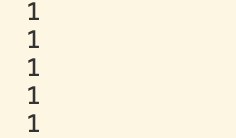

生命周期（Lifetime）：变量在内存中实际存活多长时间（何时被创建，何时被销毁释放）。
作用域（Scope）：变量在代码的哪些位置是可见且可以被访问的


局部静态变量的本质结合
- 常规局部变量：作用域仅限于函数内部，生命周期也是局部的（离开函数就销毁）。
- 全局变量：生命周期伴随整个程序，但作用域是全局可见的（任何地方都能乱改）。
- 局部静态变量（Local Static）的独特魅力：
  它把两者的优势完美结合：生命周期等同于整个程序的运行周期（静态存储期），但它的访问作用域被严格封锁在该局部函数内部

局部静态变量拥有 静态存储期（Static Storage Duration）。在底层内存布局中，它根本不在栈上分配，而是存放在程序进程的 数据段（.data 或 .bss 内存段） 中。它的内存空间在程序加载时就已经准备好了，但真正的对象初始化会延迟到程序执行流首次经过它时触发

### 举例

```cpp
void Function() {
    int i = 0;
    i++;
    std::cout << i << std::endl;
}

int main() {
    Function(); Function(); Function(); Function(); Function();
}
```


### 把变量提到函数外部
```cpp
int i = 0; // 全局变量
void Function() {
    i++;
    std::cout << i << std::endl;
}
```
虽然能输出 1 2 3 4 5，但这极其危险：因为i是全局可见的，任何其他函数、任何人都可以随便写 i = 10;，瞬间破坏状态，造成全局状态污染